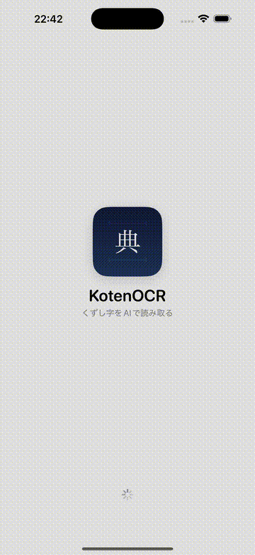
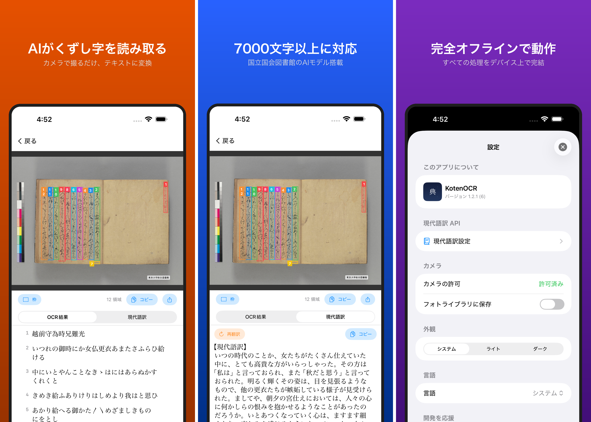

# KotenOCR

[English](README.md) | **日本語**

古典籍・くずし字と近代活字をAIで読み取るiOS OCRアプリ。
国立国会図書館の [NDL古典籍OCR-Lite](https://github.com/ndl-lab/ndlkotenocr-lite) および [NDLOCR-Lite](https://github.com/ndl-lab/ndlocr-lite) モデルを搭載し、すべての処理をデバイス上で完結します。インターネット接続は不要です。

[](https://apps.apple.com/jp/app/kotenocr/id6760045646)

Android 版は [nakamura196/koten-ocr-android](https://github.com/nakamura196/koten-ocr-android) にあります。

### デモ





## 機能

- **2つのOCRモード** — 古典籍（くずし字）と近代（活字・手書き）を切り替えて使用
- **カメラ撮影 / フォトライブラリ** — 撮影または選択してOCR実行
- **認識結果の閲覧・編集** — 検出領域のボックス表示、テキスト手動修正
- **エクスポート** — テキスト共有 / TXT / PDF
- **スキャン履歴** — OCR結果を自動保存
- **現代語訳** — 古文を現代語に翻訳
  - ローカルAI（Apple Foundation Models, iOS 26+、オフライン）
  - クラウドAPI（OpenAI互換）
- **多言語対応** — 日本語 / English
- **応援（Tip Jar）** — StoreKit 2によるアプリ内課金

## OCRモード

| モード | 対象 | 検出 | 認識 |
|--------|------|------|------|
| 古典籍 | くずし字 | RTMDet-S | PARSeq (1 model) |
| 近代 | 活字・手書き | DEIMv2-S | PARSeq cascade (3 models) |

認識処理は並列化されており、近代モードでは最大6.7倍の高速化を実現しています。

## 要件

- iOS 16.0+
- Xcode 15.0+
- Swift 5.9

## セットアップ

```bash
git clone https://github.com/nakamura196/koten-ocr-ios.git
cd koten-ocr-ios

# ONNXモデルのダウンロード（合計約230MB）
./setup.sh

# Xcodeプロジェクトの生成
xcodegen generate

open KotenOCR.xcodeproj
```

### ONNXモデル

`KotenOCR/Models/` に配置（`.gitignore` で除外済み、`setup.sh` で自動ダウンロード）。

#### 古典籍（NDL古典籍OCR-Lite）

| モデル | ファイル | サイズ |
|--------|----------|--------|
| テキスト検出 (RTMDet-S) | `rtmdet-s-1280x1280.onnx` | ~40MB |
| 文字認識 (PARSeq) | `parseq-ndl-32x384-tiny-10.onnx` | ~38MB |

#### 近代（NDLOCR-Lite）

| モデル | ファイル | サイズ |
|--------|----------|--------|
| レイアウト検出 (DEIMv2-S) | `deim-s-1024x1024.onnx` | ~38MB |
| 文字認識 30文字 (PARSeq) | `parseq-ndl-16x256-30-...onnx` | ~34MB |
| 文字認識 50文字 (PARSeq) | `parseq-ndl-16x384-50-...onnx` | ~35MB |
| 文字認識 100文字 (PARSeq) | `parseq-ndl-16x768-100-...onnx` | ~39MB |

## ビルド

```bash
# Debug build
xcodebuild build \
  -project KotenOCR.xcodeproj \
  -scheme KotenOCR \
  -destination 'generic/platform=iOS'

# App Store 用アーカイブ
./scripts/archive.sh
```

## ライセンス

このプロジェクトは [MIT License](LICENSE) のもとで公開されています。

### OCRモデル（第三者由来）

モデルはこのリポジトリの MIT ライセンスの対象外です。`setup.sh` が配布元から取得するもので、それぞれのライセンスに従います。

- **NDL古典籍OCR-Lite** — [CC-BY-4.0](https://creativecommons.org/licenses/by/4.0/)（国立国会図書館）
- **NDLOCR-Lite** — [CC-BY-4.0](https://creativecommons.org/licenses/by/4.0/)（国立国会図書館）

### 依存ライブラリ

- **ONNX Runtime** — [MIT License](https://github.com/microsoft/onnxruntime/blob/main/LICENSE)（Microsoft）

### アイコンのフォント・画像

- アプリアイコンの「典」は **Noto Serif JP**、背景の仮名は **Yuji Syuku** を使い、画像に変換して収録しています。どちらも [SIL Open Font License 1.1](https://openfontlicense.org)。フォントファイル自体はアプリに含みません（生成手順: `scripts/render_app_icon.py`）。
- 初回説明の写本画像は、東京大学総合図書館所蔵『源氏物語』（テスト用サンプルと同じ写本）の画像 01_0006 の右頁を切り出したものです。表示する枠と文字は、この画像にアプリの古典籍OCRを実際にかけた結果です（`scripts/make_onboarding_sample.py` と `KotenOCRTests/OnboardingSampleGenerator.swift` で再生成）。画像はパブリックドメインで、[総合図書館の利用条件](https://www.lib.u-tokyo.ac.jp/ja/library/general/reuse)に従い、アプリ内に「『源氏物語』（東京大学総合図書館所蔵）を改変」と表示しています。
- ホーム画面の「サンプルの頁で試す」の 3 枚は、『竹取物語』（国立国会図書館デジタルコレクション 1287221、コマ 2 を切り出し）、『国立国会図書館スタッフ・マニュアル E-2』（同 2531162、コマ 24。[NDLOCR-Lite](https://github.com/ndl-lab/ndlocr-lite) 同梱の画像）、上と同じ東京大学総合図書館所蔵『源氏物語』01_0004 の左頁です。アプリ内では出典を「国立国会図書館デジタルコレクション」「『源氏物語』（東京大学総合図書館所蔵）を改変」と表示しています。

## 引用

研究などで使う場合は [CITATION.cff](CITATION.cff) の形式で引用してください（GitHub に「Cite this repository」ボタンが出ます）。上記の国立国会図書館のモデルも合わせて引用してください。

## 作者

中村 覚（東京大学）

支援: [GitHub Sponsors](https://github.com/sponsors/nakamura196) / [Ko-fi](https://ko-fi.com/nakamura196) / [Buy Me a Coffee](https://buymeacoffee.com/nakamura196)
