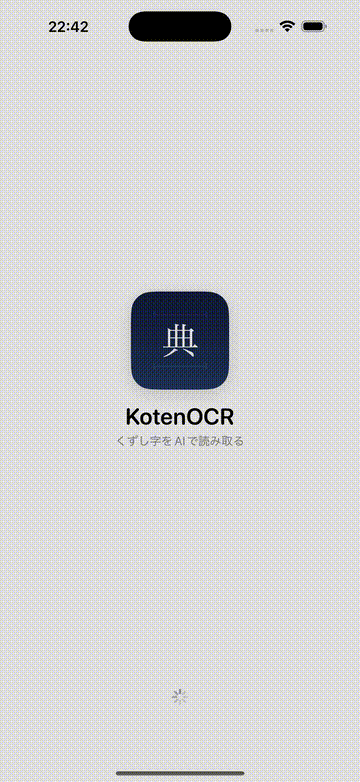
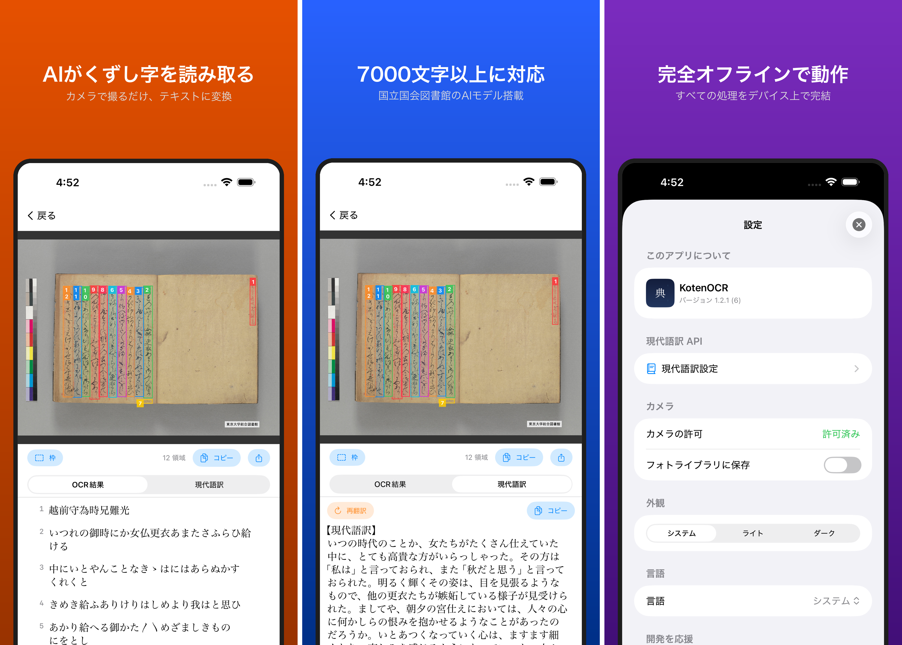

# KotenOCR

**English** | [日本語](README.ja.md)

An iOS OCR app that reads classical Japanese cursive script (kuzushiji) and modern printed text using AI.
It runs the National Diet Library's NDL Koten OCR-Lite and NDLOCR-Lite models. All processing runs entirely on-device, so no internet connection is required.

[](https://apps.apple.com/jp/app/kotenocr/id6760045646)

An Android version is available at [nakamura196/koten-ocr-android](https://github.com/nakamura196/koten-ocr-android).

### Demo





## Features

- **Dual OCR modes**: switch between Classical (kuzushiji) and Modern (printed/handwritten) modes
- **Camera and Photo Library**: capture or select images for OCR
- **View and edit results**: bounding box overlay and manual text correction
- **Export**: share text, TXT, or PDF
- **Scan history**: OCR results are saved automatically
- **Modern translation**: translate classical Japanese into modern Japanese
  - Local AI (offline; Apple Foundation Models, iOS 26+)
  - Cloud API (OpenAI-compatible)
- **Multilingual UI**: Japanese / English
- **Tip Jar**: in-app tips via StoreKit 2

## OCR modes

| Mode | Target | Detection | Recognition |
|------|--------|-----------|-------------|
| Classical | Kuzushiji | RTMDet-S | PARSeq (1 model) |
| Modern | Printed and handwritten text | DEIMv2-S | PARSeq cascade (3 models) |

Recognition is parallelized, giving up to 6.7x speedup in Modern mode.

## Requirements

- iOS 16.0+
- Xcode 15.0+
- Swift 5.9

## Setup

```bash
git clone https://github.com/nakamura196/koten-ocr-ios.git
cd koten-ocr-ios

# Download ONNX models (~230MB total)
./setup.sh

# Generate Xcode project
xcodegen generate

open KotenOCR.xcodeproj
```

### ONNX models

Placed in `KotenOCR/Models/` (gitignored, downloaded automatically by `setup.sh`).

#### Classical (NDL Koten OCR-Lite)

| Model | File | Size |
|-------|------|------|
| Text detection (RTMDet-S) | `rtmdet-s-1280x1280.onnx` | ~40MB |
| Character recognition (PARSeq) | `parseq-ndl-32x384-tiny-10.onnx` | ~38MB |

#### Modern (NDLOCR-Lite)

| Model | File | Size |
|-------|------|------|
| Layout detection (DEIMv2-S) | `deim-s-1024x1024.onnx` | ~38MB |
| Recognition, 30-char (PARSeq) | `parseq-ndl-16x256-30-...onnx` | ~34MB |
| Recognition, 50-char (PARSeq) | `parseq-ndl-16x384-50-...onnx` | ~35MB |
| Recognition, 100-char (PARSeq) | `parseq-ndl-16x768-100-...onnx` | ~39MB |

## Build

```bash
# Debug build
xcodebuild build \
  -project KotenOCR.xcodeproj \
  -scheme KotenOCR \
  -destination 'generic/platform=iOS'

# Archive for App Store
./scripts/archive.sh
```

## License

This project is released under the [MIT License](LICENSE).

### OCR models (third-party)

The models are not part of this repository's MIT license. They are downloaded by `setup.sh` from the upstream repositories and remain under their own licenses.

- **NDL Koten OCR-Lite** ([ndlkotenocr-lite](https://github.com/ndl-lab/ndlkotenocr-lite)): [CC-BY-4.0](https://creativecommons.org/licenses/by/4.0/), National Diet Library, Japan
- **NDLOCR-Lite** ([ndlocr-lite](https://github.com/ndl-lab/ndlocr-lite)): [CC-BY-4.0](https://creativecommons.org/licenses/by/4.0/), National Diet Library, Japan

### Dependencies

- **ONNX Runtime**: [MIT License](https://github.com/microsoft/onnxruntime/blob/main/LICENSE) (Microsoft)

### Icon fonts and images

- The 典 in the app icon uses **Noto Serif JP** and the background kana use **Yuji Syuku**, both under the [SIL Open Font License 1.1](https://openfontlicense.org). They are rendered into the icon images; the font files are not shipped (see `scripts/render_app_icon.py`).
- The manuscript page in the first-run introduction is the right-hand page of image 01_0006 of the Tale of Genji manuscript held by the University of Tokyo General Library (the same manuscript as the test sample). Its boxes and text are a real result of the app's Koten OCR, regenerated with `scripts/make_onboarding_sample.py` and `KotenOCRTests/OnboardingSampleGenerator.swift`. The image is in the public domain; following the library's [reuse terms](https://www.lib.u-tokyo.ac.jp/ja/library/general/reuse), the app shows "Image courtesy of the University of Tokyo General Library - The Tale of Genji / transformed".
- The three pages behind "Try a sample page" on the home screen are Taketori Monogatari (NDL Digital Collections 1287221, frame 2, cropped), the NDL Staff Manual E-2 (NDL Digital Collections 2531162, frame 24, as bundled with NDLOCR-Lite) and the left-hand page of image 01_0004 of the same Tale of Genji manuscript. The app credits them as "National Diet Library Digital Collections" and "Image courtesy of the University of Tokyo General Library / transformed".

## Citation

If you use KotenOCR in your work, please cite it using [CITATION.cff](CITATION.cff) (GitHub shows a "Cite this repository" button). Please also cite the NDL models listed above.

## Author

Satoru Nakamura (The University of Tokyo)

Support: [GitHub Sponsors](https://github.com/sponsors/nakamura196) / [Ko-fi](https://ko-fi.com/nakamura196) / [Buy Me a Coffee](https://buymeacoffee.com/nakamura196)
