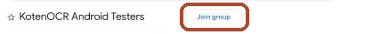
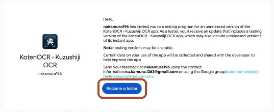
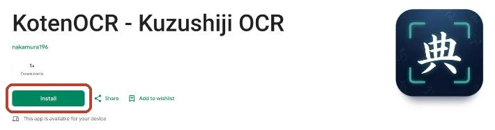

KotenOCR reads the text in a photo of a classical Japanese book (kuzushiji) or a modern Japanese document.
Recognition runs entirely on your device. Your photos never leave it.

### What we're asking

To publish an app on Google Play, at least 12 people need to stay in its test for 14 days in a row.
All you need to do is install the app and keep it for 14 days. You don't need to use it every day.

You will need:

- An Android device (Android 8.0 or later)
- The Google account you use on that device

### Join the test
{: #tester }

1. Open our Google Group, [KotenOCR Android Testers](https://groups.google.com/g/kotenocr-android-testers), and click "Join group".
   Use the Google account you use on your Android device.
   When a confirmation dialog appears, click "Join group" again.

   

2. Open the [Google Play test sign-up page](https://play.google.com/apps/testing/com.nakamura196.koten_ocr) and tap "Become a tester".
   If you open it before joining the group, it says "App not available". In that case, start from step 1.

   

3. Open [KotenOCR on Google Play](https://play.google.com/store/apps/details?id=com.nakamura196.koten_ocr) and tap "Install".
   It may take a few minutes after becoming a tester before the app is available.

   

These screenshots were taken in a desktop browser. The same buttons appear on an Android device.

> When you join, the email address of your Google account is visible to the group manager (the developer). Other members cannot see it.
> Only the manager can post to the group, so you won't normally receive email from it.
> To leave, tap "Leave the program" on the test sign-up page and leave the group.
{: .point }

Thank you so much for your help!
Please send bug reports or suggestions from the app's Google Play page, or via [GitHub Issues](https://github.com/nakamura196/koten-ocr-android/issues).

### Links

- [Home](en.html) (features and how recognition works)
- [Privacy policy](privacy-policy.html)
