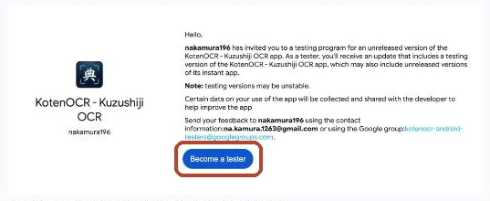
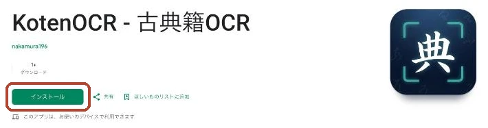

KotenOCR は、写真を撮るだけで、くずし字の古典籍や近代の文書の文字を読み取るアプリです。
読み取りは端末の中だけで行います。撮った画像を端末の外に送ることはありません。

### お願いしたいこと

Google Play で一般に公開するには、12 人以上の方に、14 日間続けてテストに参加していただく必要があります。
アプリを入れて、14 日間そのままにしておいていただくだけで大丈夫です。毎日使う必要はありません。

必要なもの:

- Android の端末（Android 8.0 以上）
- その端末で使っている Google アカウント

### テストに参加する
{: #tester }

1. Google グループ [KotenOCR Android Testers](https://groups.google.com/g/kotenocr-android-testers) を開き、「グループに参加」を押します。
   Android の端末で使っている Google アカウントで参加してください。
   確認の画面が出たら、もう一度「グループに参加」を押します。

   

2. [Google Play のテスト参加ページ](https://play.google.com/apps/testing/com.nakamura196.koten_ocr) を開き、「テスターになる」（Become a tester）を押します。
   この画面は英語で出ることがあります。
   グループに参加する前に開くと「App not available」と出ます。そのときは手順 1 から行ってください。

   

3. [Google Play の KotenOCR](https://play.google.com/store/apps/details?id=com.nakamura196.koten_ocr) を開き、「インストール」を押します。
   テスターになってから、ここに出るまで数分かかることがあります。

   

画面は、パソコンのブラウザで開いたときのものです。Android の端末でも、同じ名前のボタンが出ます。

> 参加すると、お使いの Google アカウントのメールアドレスが、管理者（開発者）に見えます。ほかのメンバーには見えません。
> グループに投稿できるのは管理者だけです。ふだんメールが届くことはありません。
> やめるときは、テスト参加ページで「テストから退出」を押し、グループから退会してください。
{: .point }

ご協力いただけますと大変助かります。
不具合やご意見は、Google Play のアプリのページから送るか、[GitHub の Issues](https://github.com/nakamura196/koten-ocr-android/issues) にお寄せください。

### リンク

- [トップページ](./)（できること・読み取りの仕組み）
- [プライバシーポリシー](privacy-policy.html)
