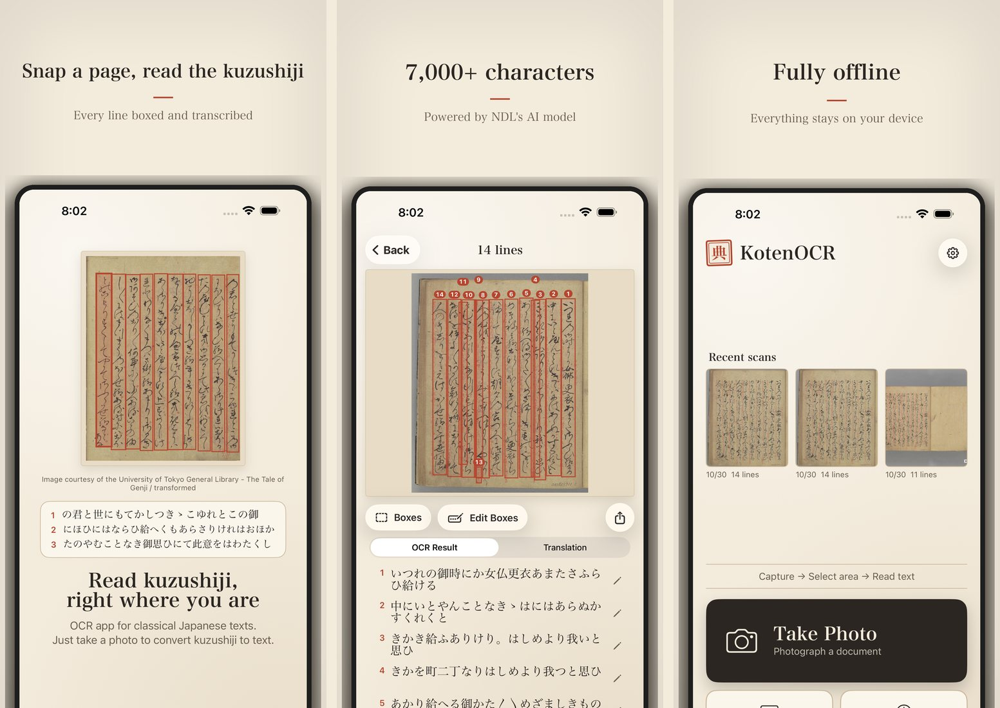

Take a photo of a page and KotenOCR draws a box around each line and reads it.
Choose between two readers: Classical, for kuzushiji in pre-modern books and manuscripts, and Modern, for printed and handwritten documents from the Meiji era on.
Your photos never leave your device.

### Download
{: #download }

| | |
| --- | --- |
| iPhone and iPad | [App Store](https://apps.apple.com/app/kotenocr/id6760045646) (free, iOS 16 or later) |
| Android | [Testers wanted](android-en.html) (Android 8 or later; Google Play release in preparation) |

The latest version is 2.1.1 (3 November 2026). See the [changelog](changelog-en.html) for what changed.

### Videos
{: #video }

The standard tutorial (about 6 minutes) is followed by the full version (about 25 minutes, 12 chapters). Narrated, with captions.

<iframe src="https://www.youtube-nocookie.com/embed/U03D9Y_1Bng?playlist=U03D9Y_1Bng,jwQ-LKgwXOo&rel=0" title="How to use KotenOCR" style="width:100%;aspect-ratio:16/9;border:0" allow="encrypted-media; picture-in-picture; fullscreen" allowfullscreen loading="lazy"></iframe>

*In 30 seconds: [short video](https://www.youtube.com/shorts/doiFpVplKB4)*

### What it does

- **Capture**: take a photo, choose one from Photos, or use Scan Document to find the page edges
- **Straighten**: Auto-correct finds the page corners and straightens a page shot at an angle; small tilts are corrected automatically before reading
- **Two readers**: choose Classical (kuzushiji) or Modern (printed and handwritten, Meiji era on) before reading
- **Edit boxes**: move, split, merge or add line boxes, then re-read only the lines you changed
- **Confidence**: raise the slider to hide the least certain lines (display only; the results are kept)
- **Translation**: translate classical text into modern Japanese, with the on-device AI on iOS 26 or later, or a cloud API you choose (OpenAI, OpenRouter, etc.)
- **History and export**: results stay on your device; export as text, TXT or PDF
- **Try a sample**: three bundled pages (Taketori Monogatari, The Tale of Genji, and an NDL document) to try without taking a photo

### How it reads

KotenOCR runs two OCR systems published by the National Diet Library (NDL) on the iPhone itself.

| Reader | Models | Best for |
| --- | --- | --- |
| Classical | [NDL Koten OCR-Lite](https://github.com/ndl-lab/ndlkotenocr-lite) (line detection RTMDet, recognition PARSeq) | Kuzushiji in woodblock prints and manuscripts up to the Edo period; 7,000+ characters |
| Modern | [NDLOCR-Lite](https://github.com/ndl-lab/ndlocr-lite) (line detection DEIMv2, three PARSeq models chosen by line length) | Printed and handwritten documents from the Meiji era on |

The models run on [ONNX Runtime](https://github.com/microsoft/onnxruntime). No internet connection is needed for reading.

### What is sent, and what is not

> Images are never sent off the device, by any feature.
> Only when you choose a cloud API for translation is the recognized text sent to the provider you chose.
> See the [privacy policy](privacy-policy.html) for details.
{: .point }

### Links

- [Changelog](changelog-en.html)
- [Source code](https://github.com/nakamura196/koten-ocr-ios)
- [Privacy policy](privacy-policy.html)
- [Bug reports and requests](https://github.com/nakamura196/koten-ocr-ios/issues) (or use Send Feedback in the app's Settings)

### Developer

Satoru Nakamura (The University of Tokyo)
