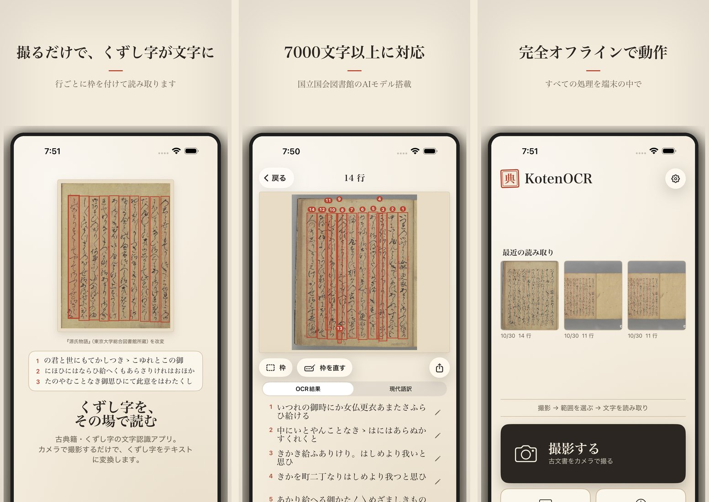

資料のページを撮ると、行ごとに枠を付けて文字を読み取ります。
くずし字の古典籍と、明治以降の活字・手書きの資料の、2 つの読み方を選べます。
撮った画像を端末の外に送ることはありません。

### ダウンロード
{: #download }

| | |
| --- | --- |
| iPhone・iPad | [App Store](https://apps.apple.com/jp/app/kotenocr/id6760045646)（無料。iOS 16 以降） |
| Android | [テスター募集中・APK 版](android.html)（Android 8 以降。Google Play での公開を準備中） |

最新版は 2.1（2026年11月1日）です。変更点は [更新履歴](changelog.html) にあります。

### 動画で見る
{: #video }

通常版（約 7 分）のあとに、詳細版（約 30 分、全 12 章）が続けて流れます。声と字幕で説明しています。

<iframe src="https://www.youtube-nocookie.com/embed/9dZoEKrrz60?playlist=9dZoEKrrz60,CpQn9wZKgQ4&rel=0" title="KotenOCR の使い方" style="width:100%;aspect-ratio:16/9;border:0" allow="encrypted-media; picture-in-picture; fullscreen" allowfullscreen loading="lazy"></iframe>

*30 秒で見る: [ショート動画](https://www.youtube.com/shorts/4CoLQXBxP6E)*

### できること

- **撮る・選ぶ**: カメラで撮るほか、写真から選べます。書類スキャンで、ページの端を見つけて取り込むこともできます
- **まっすぐに直す**: 斜めに撮ったページは「自動補正」で四隅を見つけて直します。小さな傾きは読む前に自動で直します
- **2 つの読み方**: 古典籍（くずし字）と近代（明治以降の活字・手書き）を、読む前に選びます
- **枠を直す**: 読み取った行の枠を動かす・分ける・まとめる・足すことができ、変えた行だけを読み直します
- **確信度**: スライダーを上げると、自信のない行から隠れます（表示だけで、結果は変わりません）
- **現代語訳**: 古文を現代語に訳します。iOS 26 以降は端末の中の AI で、それより前はクラウドの API（OpenAI・OpenRouter など）を選べます
- **履歴と書き出し**: 読んだ結果は端末の中に残ります。テキスト・TXT・PDF で書き出せます
- **サンプルで試す**: 『竹取物語』『源氏物語』と国立国会図書館の資料の 3 頁を、撮らずにすぐ試せます

### 読み取りの仕組み

国立国会図書館が公開している 2 つの OCR を、iPhone の中で動くようにしています。

| 読み方 | 使うモデル | 向いている資料 |
| --- | --- | --- |
| 古典籍 | [NDL古典籍OCR-Lite](https://github.com/ndl-lab/ndlkotenocr-lite)（行の検出 RTMDet、文字の認識 PARSeq） | 江戸期までの版本・写本のくずし字。7,000 字以上 |
| 近代 | [NDLOCR-Lite](https://github.com/ndl-lab/ndlocr-lite)（行の検出 DEIMv2、行の長さで選ぶ 3 つの PARSeq） | 明治以降の活字の印刷物、手書きの文書 |

モデルは [ONNX Runtime](https://github.com/microsoft/onnxruntime) で動かします。
読み取りにインターネットは要りません。

### 送るもの・送らないもの

> 画像は、どの機能でも端末の外に送りません。
> 現代語訳でクラウドの API を選んだときだけ、読み取ったテキストが、選んだ事業者に送られます。
> くわしくは [プライバシーポリシー](privacy-policy.html) にあります。
{: .point }

### リンク

- [更新履歴](changelog.html)
- [ソースコード](https://github.com/nakamura196/koten-ocr-ios)
- [プライバシーポリシー](privacy-policy.html)
- [不具合の報告・ご要望](https://github.com/nakamura196/koten-ocr-ios/issues)（アプリの設定の「フィードバックを送る」からも送れます）

### 開発

中村 覚（東京大学）
